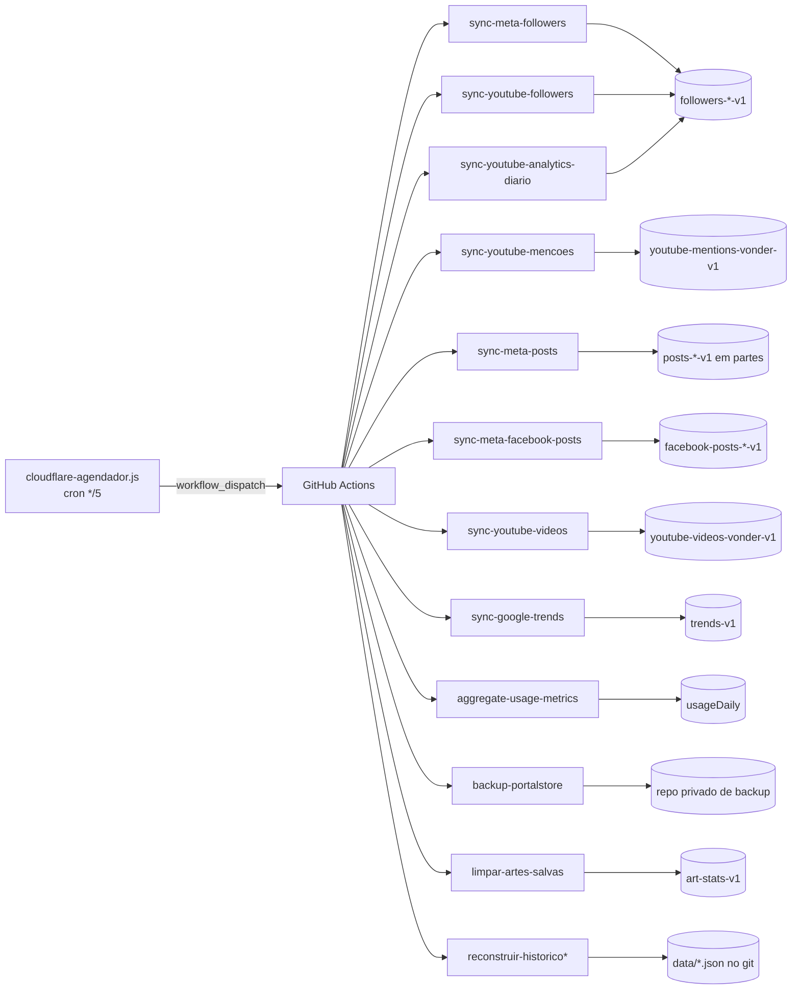
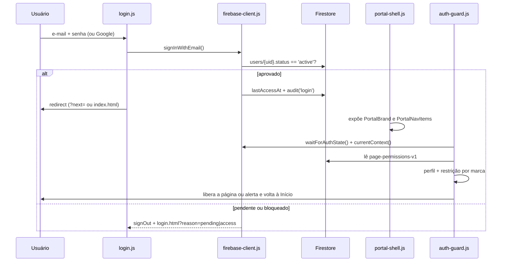
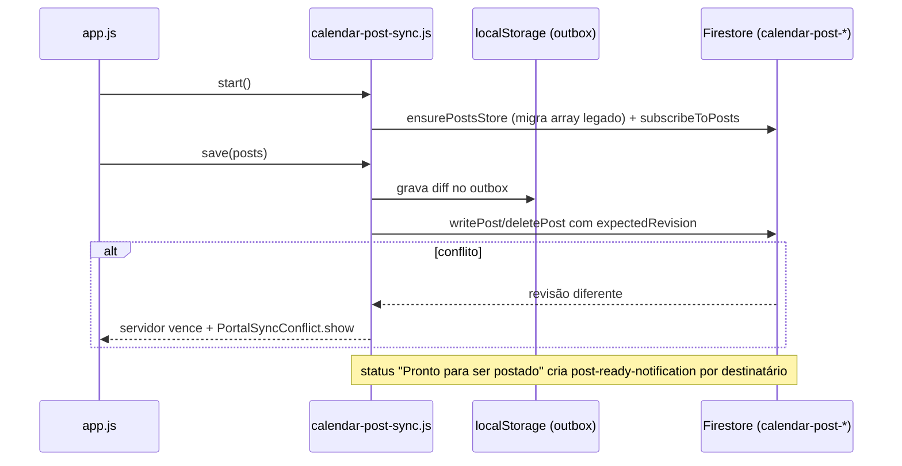
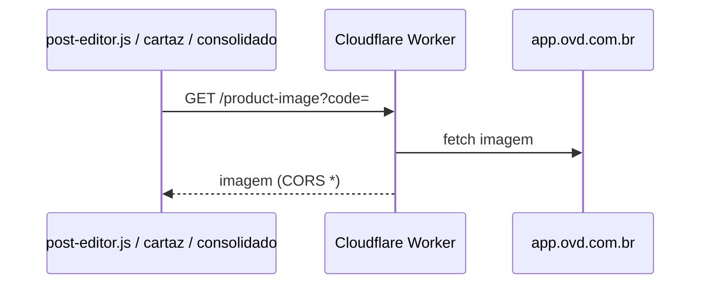

# Codebase Map

> Atualizado pelo Cartographer em 21/10/2026 (mapa anterior: 09/09/2026). Esta atualização releu o código por módulo; o que não foi lido linha a linha está indicado no texto. Linhas citadas são aproximadas.
>
> **Nota sobre o volume:** dos 7.911 arquivos versionados, a maioria é dado gerado, não lógica: `post-editor-assets/brands-js/*.js` (logos em data:URI), `data/social-posts-thumbnails/` (~650 MB de miniaturas de posts) e os `business-card-*-assets.js` / `business-card-print-profile.js`. O código-fonte real do portal está em ~265 arquivos. Pasta `.claude/worktrees/` contém cópias do projeto e deve ser ignorada em buscas.

## System Overview

```mermaid
graph TB
    subgraph Cliente["Navegador (estático, sem build step)"]
        Shell[portal-shell.js<br/>sidebar, marca ativa, tema, notificações]
        Home[index.html + home-map.js<br/>Início e mapa 3D admin]
        Cal[visual-editor.html + app.js<br/>Calendário]
        Editor[post-editor.html + post-editor.js<br/>Editor de Artes]
        Ger[gerador.html<br/>Cartazes, Consolidado, Cartão,<br/>Código de Barras, QR]
        Conecta[conecta-fg.html<br/>Conversor de blog FG]
        Tpl[templates.html<br/>Marketplaces]
        Marcas[marcas.html<br/>Biblioteca de marcas]
        Followers[followers-dashboard.html<br/>Redes sociais]
        Mon[monitoramento.html<br/>Menções YouTube]
        Intel[intelligence-center.html<br/>Google Trends]
        Usage[usage-dashboard.html<br/>Métricas de uso]
        Admin[admin-users.html<br/>Usuários e perfis]
        Notif[notifications.html]
    end

    subgraph Auth["Autenticação"]
        Login[login.html/.js]
        Guard[auth-guard.js]
        FBClient[firebase-client.js]
        Cfg[firebase-config.js<br/>PRD ou HML por hostname]
    end

    subgraph Firebase["Firebase (Auth + Firestore, plano Spark)"]
        FireAuth[(Auth)]
        FireStore[(Firestore: users, portalStore,<br/>securityAudit, usageEvents/Daily,<br/>qrCodes/qrHits, artPhotos, brandLogos)]
    end

    subgraph CF["Cloudflare"]
        Worker[cloudflare-worker.js<br/>proxy de foto, link e catálogo FG]
        Agend[cloudflare-agendador.js<br/>cron */5, único disparo dos coletores]
    end

    subgraph Externo["Serviços externos"]
        Meta[Meta Graph API<br/>Instagram e Facebook]
        YT[YouTube Data API v3 + Analytics]
        Trends[Google Trends - pytrends]
        OvdFotos[app.ovd.com.br]
        FgSite[fg.com.br]
    end

    subgraph CI["GitHub Actions (18 workflows)"]
        Coletores[sync-meta-*, sync-youtube-*,<br/>sync-google-trends, reconstruir-historico-*]
        Manut[aggregate-usage-metrics, backup-portalstore,<br/>limpar-artes-salvas, copiar-dados-prd-para-hml]
        Valid[testes, validar-documentacao-arquitetura]
    end

    Login --> FBClient --> FireAuth
    Guard --> FBClient
    Cfg --> FBClient
    Shell --> Guard
    Cal & Editor & Ger & Conecta & Tpl & Marcas & Followers & Mon & Intel & Usage & Admin & Notif & Home --> Shell
    Cal & Editor & Ger & Tpl & Marcas & Followers & Mon & Intel & Usage & Admin & Notif --> FBClient --> FireStore

    Editor & Ger & Conecta --> Worker
    Worker --> OvdFotos
    Worker --> FgSite

    Agend -->|workflow_dispatch| Coletores
    Agend -->|workflow_dispatch| Manut
    Coletores --> Meta & YT & Trends
    Coletores -->|Admin SDK| FireStore
    Manut -->|Admin SDK| FireStore
```



## Directory Structure

```
/ (raiz - páginas e módulos do portal, tudo estático)
├── index.html / .js / .css / home-map.js / home-auth.js   Início (cards de ferramentas, seletor de marca, busca; mapa 3D só admin)
├── login.html / .js, auth-guard.js, auth.css              Login, gate de permissão, estilos de auth
├── portal-shell.js                                        Sidebar, marca ativa, tema, menu da conta (1º script de toda página)
├── firebase-client.js / firebase-config.js / firestore.rules   Camada Firebase, config PRD/HML, regras
├── sync-backend.js (14 linhas) / api.php                  Wrapper get/put/remove sobre PortalFirebase; api.php é resquício
├── calendar-post-sync.js                                  Sincronizador do calendário por card
├── visual-editor.html + app.js                            Calendário de Postagens
├── post-editor.html / .js / .css, post-editor-*.js        Editor de Artes e presets por marca
├── post-editor-assets/                                    Logos e presets por marca (gerado, enorme)
├── gerador.html                                           Hub do menu Gerador
├── cartaz-*.js/.css/.html, consolidado-*, barcode-generator.*, qr-code-generator.*   Geradores
├── business-card-generator.* + business-card-*-assets.js  Cartão de visita (dados só em localStorage)
├── conecta-fg.html / .js                                  Conversor .docx → código WordPress (blog Conecta FG)
├── templates.html / .js                                   Templates de marketplaces por marca
├── marcas.html / .js / .css, brand-library*.js, brand-export.js   Biblioteca de marcas (logos)
├── followers-dashboard.*, monitoramento.*                 Redes sociais e menções do YouTube
├── intelligence-center.*, intelligence-data.js            Google Trends (tela) e DNA de editoria (motor usado pelo calendário)
├── admin-users.*, notifications.*, usage-analytics.js, usage-dashboard.*   Administração, notificações, métricas
├── migrate-followers.*, import-legacy-calendar.html       Ferramentas pontuais
├── photoshop-actions.html, photoshop-action-prepare-spanish.html   Ações do Photoshop
├── politica-de-privacidade.html, termos-de-uso.html       Páginas legais
├── cloudflare-worker.js, cloudflare-agendador.js          Workers (republicados manualmente no Cloudflare)
├── _headers                                               CSP/nosniff/Referrer-Policy (só Cloudflare Pages)
├── styles.css, DESIGN.md                                  Design system e padrões de interface
├── vendor/                                                xlsx, jszip, html2canvas, jspdf, qrcode-generator
├── data/                                                  Snapshots de CI e catálogos (ver Módulo de dados)
├── scripts/                                               6 scripts Python usados pelos workflows
├── tests/                                                 ~20 testes (.html abertos em Chrome headless, .py, .ps1) + harnesses _pilar-*.html
├── .github/workflows/                                     18 workflows
├── docs/ARQUITETURA-E-INTEGRACOES.md                      Fonte de verdade de integrações (manual)
└── AGENTS.md / CLAUDE.md                                  Guia para agentes
```

## Module Guide

### Portal shell, autenticação e infraestrutura

**Propósito**: casca comum (sidebar, tema, marca ativa), login/sessão, permissões e camada de dados Firebase.

| Arquivo | Papel | ~linhas |
|---|---|---|
| `portal-shell.js` | Sidebar, `PortalBrand`, `PortalNavItems`, tema, menu Conta (Perfil com recorte de foto, Notificações, Configurações, Redefinir senha, Sair), badge de notificações (só perfil `social-media`), modal compartilhado de conflito | 1504 |
| `auth-guard.js` | Gate de login, permissão por perfil e restrição por marca; módulo adiado | 113 |
| `firebase-client.js` | Única porta para Auth e Firestore (ver exports abaixo) | 502 |
| `firebase-config.js` | `PROD_CONFIG` (projeto `mkt-ovd`) e `HML_CONFIG` (`mkt-ovd-hml`), escolhidos por hostname; `PORTAL_AUTH_POLICY` | 36 |
| `firestore.rules` | Regras server-side | 129 |
| `sync-backend.js` | `window.SyncBackend = {get, put, remove}` sobre `PortalFirebase`; sem fallback para `api.php` | 14 |
| `calendar-post-sync.js` | Sincronizador do calendário por card (ver abaixo) | 234 |
| `login.html` / `login.js` | E-mail/senha, Google, reset; `?next=` só aceita `.html` local; `?reason=pending\|access` | 48 / 24 |
| `admin-users.html` / `.js` | Usuários, perfis (CRUD), permissões por perfil, marcas de notificação | 116 / 732 |
| `notifications.html` / `.js` | Lista de "post pronto para postar" do usuário | 1 (minificado) / 29 |
| `usage-analytics.js` | `PortalUsage.track(tool, action, {quantity, dedupeKey, brandId})`: só entregas concluídas | 17 |
| `usage-dashboard.html` / `.js` | Métricas de uso: lê `usageDaily` | min. / 80 |
| `_headers` | CSP só com `script-src` (gstatic, jsdelivr), `object-src 'none'`, `frame-ancestors 'self'`; sem `connect-src`/`img-src` de propósito (primeiro CSP Report-Only em HML) | 10 |
| `mouse-light.js`, `catalog-provider.js` | Brilho de fundo; `CatalogProvider.load(slug)` lê `data/catalog-<slug>.json` com timeout de 8 s e cache `catalog_cache_v1__<slug>`, nunca rejeita | 10 / 20 |

**Ambiente**: só `vonderferramentas-coder.github.io` e `portalmktovd.pages.dev` usam produção. Qualquer outro host (localhost, preview, `file://`) cai em HML, de propósito.

**`firebase-client.js`**: exports de módulo ES incluem `signInWithEmail`, `signInWithGoogle`, `requestPasswordReset`, `logout`, `currentContext`, `waitForAuthState`, `hasRole`, `readPortalStore`, `writePortalStore`, `deletePortalStore`, cards do calendário (`ensurePostsStore`, `writePost`, `deletePost`, `subscribeToPosts`), artes salvas (`readArtDraft`, `writeArtDraft`, `lockArtDraft`, `releaseArtDraftLock`, `setArtDraftDeleted`, `renameArtDraft`, `listArtDrafts`, `writeArtPhoto`, `readArtPhoto`, `readArtStats`), logos (`readBrandLogo`, `writeBrandLogo`, `deleteBrandLogo`), notificações (`subscribeNotifications`, `markNotificationRead`), `updateOwnProfile`, `recordUsageEvent`, QR (`listQrCodes`, `writeQrCode`, `deleteQrCode`, `countQrHits`, `readQrHits`), `audit`. `window.PortalFirebase` (script clássico) expõe só um subconjunto, **sem** `signIn*`, `waitForAuthState` nem as funções de QR; dispara o evento `portal-firebase-ready`, que `sync-backend.js` e `calendar-post-sync.js` aguardam. SDK Firebase 12.18.0 via gstatic.

**Coleções e documentos**:

| Onde | Conteúdo |
|---|---|
| `users/{uid}` | `name`, `email`, `role`, `status`, `notificationBrands[]`, `photo`, `createdAt`, `lastAccessAt` |
| `portalStore/{key}` | `{v, updated_at, updatedAt}`; escrita por transação comparando `updated_at` |
| `portalStore/calendar-post-{storeKey}-{postId}` | um documento por card do calendário (`revision`) |
| `portalStore/calendar-meta-{storeKey}` | lease de migração do array legado |
| `portalStore/post-ready-notification-{key}-{postId}-{rev}-{uid}` | notificação por destinatário |
| `portalStore/art-draft-{marca}-{id}` | arte salva (`revision`, `lock{uid,name,until}`, bloqueio de 10 min) |
| `portalStore/art-stats-v1` | gravado só pelo Admin SDK |
| `artPhotos/{hash}`, `brandLogos/{id}`, `usageEvents`, `usageDaily`, `qrCodes`, `qrHits`, `securityAudit` | ver regras abaixo |

**`firestore.rules`**: funções `activeUser()`, `admin()`, `brandEditor()` (admin ou `criacao`), `isControlDoc` (`user-profiles-v1`, `page-permissions-v1`, `social-media-notification-routes-v1`, `brand-library-v1`) e `isCollectedDataDoc` (regex `followers|posts|youtube-videos|youtube-mentions|facebook-posts|trends|art-stats` seguido de `-`). `portalStore`: leitura por qualquer ativo; escrita por admin, por `brandEditor` em `brand-library-v1`, ou por qualquer ativo se o documento não for de controle nem coletado. `users/{id}`: o dono só altera `lastAccessAt`, `name` e `photo`. `usageEvents`: create com schema fixo (quantidade 1..10000), leitura só admin. `usageDaily`: leitura admin ou `gestao`, sem escrita pelo navegador. `qrCodes`: leitura por ativo, escrita pelo dono ou admin. `qrHits`: create **público** com campos mínimos validados. `artPhotos`: id de 32 hex, até 700 KB, imutável. `brandLogos`: até 400 KB, escrita por `brandEditor`.

**`auth-guard.js`**: aguarda o estado de login, lê `currentContext`, confere `data-auth-role` (se houver) e aplica `page-permissions-v1` (`{perfil: [hrefs]}`). Admin recebe todas as páginas de `PortalNavItems`. Perfil sem entrada no mapa cai no padrão: tudo menos as `defaultHidden` (`admin-users.html`, `marcas.html`, `usage-dashboard.html`). `index.html` é sempre liberada. Itens com `brands:[...]` somem nas outras marcas, mesmo para admin (hoje: `cartaz-generator.html` e `consolidado-generator.html` só em `grupo-ovd`; `conecta-fg.html` só em `ferramentas-gerais`; `monitoramento.html` só em `default`). Sem permissão: `alert` e volta à Início, mantendo a sessão; só falha de sessão faz logout. Expõe `window.PortalAccess.refresh()`. `notifications.html` não está em `NAV_ITEMS`: qualquer perfil logado acessa.

**`portal-shell.js`**: `window.PortalShell = {readBrandPhoto, svgIcon, setActiveBrand}` e `window.PortalSyncConflict = {show, hide}` (contextos `posts`, `settings`, `intelligence`). Menu em grupos; o hub **Gerador** (`gerador.html`) tem filhos Cartazes, Consolidado, Código de Barras e QR Codes; o estado aberto fica em `portal-nav-group-open:<href>`. `DEFAULT_BRANDS` tem 9 marcas com ids fixos (`default`, `ferramentas-gerais`, `osten-ferragens`, `dismatal`, `toolmix`, `dwt`, `nove54`, `grupo-ovd`, `pilar-tecnologia`), cores em `themeColor`/`themeColorInk`/`onAccent` (ver DESIGN.md §7). A lista é sincronizada com `SyncBackend` na chave `brands` (poll de 20 s, push com debounce de 700 ms). `?brand=<id>` na URL define a marca ativa (é como o link da notificação funciona). Chaves de `localStorage`: `portal_brands_v1`, `portal_active_brand_v1`, `portal_sidebar_collapsed_v1`, `calendar_theme_v1`, `calendar_color_theme_v1`, `calendar_color_theme_custom_v1`, `calendar_theme_source_v1`, `portal-nav-group-open:<href>`. A Início troca de marca sem recarregar; as demais páginas fazem `location.reload()`.

**`calendar-post-sync.js`** (calendário por card): `CalendarPostSync.create({storeKey, localKey, outboxKey, getPosts, applyPosts, readLegacy, onRemoteChange, onStatus, onConflict, getReadyNotificationRecipients})` devolve `{start, save, flush, beginEdit, endEdit, destroy}`. `start()` chama `ensurePostsStore` (migra o array legado em lotes de 400 com lease de 60 s) e `subscribeToPosts` (`onSnapshot` filtrado por `calendarStoreKey`). `save()` calcula o diff contra o último estado do servidor, grava no outbox (`localStorage`) e chama `writePost`/`deletePost` com `expectedRevision`; falha repete a cada 5 s e reconcilia ao voltar `online` e em `pagehide`. Em conflito **o servidor vence** e o modal de conflito aparece. `beginEdit`/`endEdit` fixam a revisão do card aberto e adiam alterações remotas dele. `flush()` só resolve depois de gravar (o atalho "Abrir editor direto" depende disso). Notificação: gerada em `writePost` só quando o status passa a "Pronto para ser postado" (não se já era "Aprovado" ou "Pronto…", nem em card criado direto nesse status); destinatários vêm de `social-media-notification-routes-v1` filtrados pela marca. As **configurações** continuam no caminho antigo (`SyncBackend.get/put` com versão da chave inteira). A busca e a exportação carregam todos os cards da marca, sem paginação (`ponytail` no código: partições se passar de dezenas de milhares).

**Notificações**: o admin define `notificationBrands` por usuário `social-media` e `admin-users.js` (`syncNotificationRoutes`) grava a lista inteira em `social-media-notification-routes-v1`: única fonte de verdade. `notifications.js` só lista as notificações do usuário e marca como lidas.

**`admin-users.js`**: perfis padrão `admin` (travado), `user`, `gestao`, `criacao`, `social-media` em `user-profiles-v1`; permissões em `page-permissions-v1`. Criar usuário usa um app Firebase secundário (`provision-<ts>`), senha aleatória, grava `users/{uid}` com `status:'active'` e envia e-mail de redefinição. Excluir perfil **não migra** usuários (caem no padrão). Auditoria em `securityAudit` (`login`, `logout`, `user_created`, `user_updated`, `user_status_changed`, `password_reset_requested`, `followers_migrated`); o card do log está oculto. `admin-users.html` ainda linka `migrate-followers.html`.

**Métricas de uso**: `PortalUsage.track` (carregado por cartão de visita, cartazes, Conecta FG, consolidado, marcas, ação do Photoshop em espanhol e editor de posts) grava em `usageEvents`; `aggregate-usage-metrics.yml` agrega em `usageDaily` e apaga eventos com mais de 90 dias; `usage-dashboard.js` lê os últimos 90 dias e filtra no cliente. Os mapas `toolNames`/`brandNames` do dashboard são fixos no código (ferramenta ou marca nova aparece com o id cru). Só os eventos `pdf_export` (cartão), `export` (cartaz, editor) foram vistos; não achei `track` em Conecta FG nem Photoshop.

**Início**: `index.html` tem 12 cards de ferramenta; `index.js` faz busca sem acento (tecla `/` foca, Enter abre o primeiro) e troca de marca por `PortalShell.setActiveBrand` + `PortalAccess.refresh`. `home-map.js` é um mapa 3D (Three.js r149 via jsdelivr, carregado só ao abrir) que só aparece para `role=admin`; os dados de pauta e usuários são **simulados**, com nomes fictícios; sem WebGL volta para a lista.

**Gotchas críticos**:
- `firebase-config.js`: `allowedEmailDomains` está **vazio** e `sessionHours` não é lido por `firebase-client.js`. Todo acesso novo depende de aprovação do admin (`users/{uid}.status == 'active'`). A sessão usa `browserSessionPersistence`.
- As regras **não distinguem qual página cada perfil vê**: isso é só interface (`auth-guard.js`). O perfil `gestao` só ganha poder real nas regras em `usageDaily`.
- **Notificações lidas por query**: qualquer usuário ativo consegue ler as de outros pelas regras; a restrição por `recipientUid` é só no cliente.
- **Rotas de notificação só são gravadas por admin** (`social-media-notification-routes-v1` é documento de controle). `admin-users.js` grava a rota **antes** de alterar o perfil (se o admin troca o próprio perfil, depois do `updateDoc` ele deixa de ser admin e as regras barrariam a escrita). `notifications.js` só lê; o autorreparo que existia nele foi removido em 21/10/2026 porque nunca podia funcionar para não-admin.
- `apiKey` do Firebase Web é pública por natureza; segredos de conta de serviço ficam só em GitHub Actions Secrets.
- Ids de documentos `calendar-meta-*`, `calendar-post-*`, `post-ready-notification-*` e `art-draft-*` usam `encodeURIComponent` no id da marca/post; backup e limpeza (`scripts/`) precisam respeitar isso.
- `.gitignore` exclui `.env*`, `*.key`, `*.pem`, `*.sqlite*`.
- Comentários antigos em `portal-shell.js`, `app.js` e `intelligence-data.js` ainda falam de `api.php`/SQLite/409; o backend ativo é só o Firestore. `api.php` ficou como resquício.
- Qualquer script novo de outro host (CDN) quebra no Cloudflare Pages por causa do CSP de `_headers`.

### Editor de Posts / Calendário (produção de arte)

**Propósito**: `visual-editor.html` (app.js, ~5000 linhas) é o **planejamento** (calendário de cards por data/canal/briefing); `post-editor.html` (post-editor.js) é a **produção de arte** (Feed 1080×1350 / Story 1080×1920), com handoff via query string (`eventTitle`, `eventDay`, etc.).

| Arquivo | Papel |
|---|---|
| `post-editor.js` | Motor de desenho em canvas (~1125 linhas, 134 KB), fluxo de 4 etapas, exportação JPG/ZIP; `SAFE_MARGINS` e `setMoveBox` (guias de margem, ver DESIGN.md §6); consome `OVD_BRAND_MANIFEST` (biblioteca de marcas) |
| `post-editor.html` / `.css` | Shell e estilos do editor |
| `post-editor-fg-ecommerce.js` | Preset "Post E-commerce" (FG) - caixa De/Por/Desconto |
| `post-editor-fg-lancamentos.js` | Preset "Lançamentos" (FG) |
| `post-editor-vonder-uso-recomendo.js` | Preset "Uso e Recomendo VONDER": faixas preta/amarela, esquerda ou direita, arrastáveis na vertical |
| `post-editor-vonder-datas-comemorativas.js` | Preset "Datas comemorativas" (VONDER): grade de 1/2/4 fotos com enquadramento e zoom por foto, losango + faixa preta com a data, forma amarela de pontas e forma branca opcional; textos editáveis por duplo clique; painel próprio (`#vcPanel`) e fonte Montserrat |
| `post-editor-saved-arts.js` | Artes salvas: receita no `portalStore` (`art-draft-*`), fotos originais no IndexedDB (hash) e cópia comprimida em `artPhotos`, bloqueio "fulano está editando", lixeira, lista e reabertura; usa `serialize()`/`restore()` do preset ou o adaptador genérico `SAVED_ADAPTER` |
| `post-editor-osten-/dismatal-/dwt-datas-comemorativas.js` | Presets "Datas comemorativas" das demais marcas |
| `scripts/purge_art_drafts.py` + `limpar-artes-salvas.yml` | Limpeza diária (lixeira de 7 dias, artes velhas de 90 dias, fotos órfãs de 30 dias, grava `art-stats-v1`) |
| `import-legacy-calendar.html` | Importação one-off de planilha para o calendário VONDER |
| `tests/_pilar-*.html` | Harnesses de QA visual do cartão PILAR (estão em `tests/`, não mais na raiz) |

**Registro**: cada preset faz `POST_EDITOR_CUSTOM_PRESETS[sufixoMarca][editoria] = {...}`; `post-editor.js` copia para `EDITORIA_PRESETS_BY_BRAND`. Sufixos: `''` (VONDER), `'__ferramentas-gerais'`, `'__osten-ferragens'`, `'__dismatal'`, `'__dwt'`. Só aparece habilitada (sem "Em breve") a editoria que tem preset; "Uso e Recomendo VONDER" é injetada por `withUso()` mesmo que o calendário não a tenha. Cada preset de marca é um clone deliberadamente isolado.

**Assinatura do renderer**: `renderer({format, canvas, ctx, t, state, item, productName, helpers})`, com `helpers = {drawCover, drawPlaceholder, contain, roundRect, font, fitFont, setMoveBox, rich}`.

**Chaves do preset além de `renderer`**: visuais e de fluxo (`footerColor`, `badgeFeed`, `badgeStory`, `brandBadgeColor`, `assetSources`, `commemorative`, `skipProductChooser`, `singleCommemorativeText`, `titleSizeControl`); controles do painel (`supportsCodes`, `supportsProductCutout`, `supportsBrandVariant`, `supportsBrandBadgeColor`, `supportsCompositionSuggestions`, `supportsOverlayScale`, `hideCircleControls`, `layoutOptions`, `moveLabel`, `moveHint`, `nameLabel`); `ecommerce` (FG), `banner:true` (cria o passo 4), `verticalOnly`, `noBackground`, `panel` (mostra `#vcPanel`); ganchos `setup(api)`, `pickTarget`/`onDrag`/`onDragEnd`, `wheel`, `dblclick` (pode devolver `{hit,box,label}`), `serialize`/`restore` (artes salvas) e `test`. Só o preset VONDER de Datas comemorativas usa `verticalOnly` (o "Uso e Recomendo" usa `usoOn()`, pelo nome da editoria). Testes em `tests/vonder-datas-comemorativas.test.html`.

**Margens de segurança**: `SAFE_MARGINS` (`post-editor.js`, ~linha 759) = feed 135/66/190 e story 190/66/190; `drawGuides` desenha as guias ciano (`#00E5FF`) só nas bordas tocadas e só durante o arraste; `guideResist` segura o elemento e empurrar `GUIDE_PUSH=40` px o solta. `setMoveBox(box)` grava `lastProductBox[format]` (`[x, y, w, h]`) e vira o alvo do duplo clique e do arraste. **Preset com `renderer` que não chama `setMoveBox` fica sem destaque selecionável.** Chamam hoje: Uso e Recomendo, Datas comemorativas VONDER e FG E-commerce.

**Fluxo**: 4 etapas (`FLOW_STEP_ORDER = editoria, choose, edit, banner`). `skipProductChooser` esconde a etapa 2; `preset.banner` mostra "Desdobrar para banner". Sair de `edit` ou `banner` com alteração abre o modal (com "Salvar antes de sair" quando há artes salvas).

**Ordem de `<script>` em `post-editor.html`** (crítica): `sync-backend`, `portal-shell`, `usage-analytics` → `brands-manifest.js` → `brand-library-model`, `brand-library` → 3 logos estáticos → presets (uso-recomendo, vonder-datas, **saved-arts**, fg-lancamentos, fg-ecommerce, osten, dismatal, dwt) → `cartaz-title-format`, `cartaz-validator`, `catalog-provider` → `post-editor.js`. `saved-arts` precisa vir antes porque `drawAll()` chama `PostEditorSaved.touch()`.

**Recursos do `post-editor.js` que o mapa anterior não tinha**:
- **Busca no site (só VONDER)**: com 3+ caracteres chama `/product-search`, `/product-catalog` e `/product-thumbs` do Worker, com retry em 5xx (`&_=Date.now()` fura o cache de borda) e registra lacunas do catálogo via `PortalUsage`.
- **Importar oferta FG** (preset `ecommerce`): `/product-offer?url=` abre o modal de SKU; o código impresso é `codeFG` (7 dígitos) e a foto vem do código VONDER (`CATALOG_PHOTO_SLUG` fg→vonder).
- **Biblioteca de logos de marca**: `OVD_BRAND_MANIFEST` + ajustes do `BrandLibrary`; `loadBrandLogoImage` injeta `<script src="post-editor-assets/brands-js/<nome>.js">` (evita CORS sob `file://`); sem o redraw assíncrono do `selectBrandLogo` a logo não aparece.
- **Texto rico** (Destaques e Uso e Recomendo da VONDER): `state.titleHtml` via `CartazTitleFormat`; `CartazValidator` revisa e formata código de 10 dígitos como `00.00.000.000` só na VONDER.
- **Artes salvas genéricas**: `SAVED_ADAPTER` serve os presets sem `serialize`; receita `v:1` com `fields`, `item` (≤6000 bytes), `st` e `photos`.
- **API pública** `window.PostEditor = {goToStep, markSaved, redraw, state, status, incoming, session, preset, editoriaName, chooseEditoria, chooseProduct, getCatalog, makeZip, exportBaseName}`.
- Outros: seções recolhíveis (`.pe-collapse`) renumeradas por `MutationObserver`; hash SHA-256 das fotos (`hashFile`); `removeWhite` com fallback de tolerância 15 e halo de 2 px; `refreshEditoriasFromServer` lê `settings<suffix>` do `SyncBackend`; `CATALOG_SLUG_BY_BRAND_SUFFIX` (`''`→vonder, `ferramentas-gerais`→fg, `dismatal`→dismatal); recentes em `pe_recent_products_v1<suffix>` (até 6).

**Preset VONDER "Datas comemorativas"**: painel `#vcPanel` (campos `vc*`); fontes Montserrat e Swiss721; pontas das formas sorteadas por semente (`shapeFor`; sementes 0 e 1 são as artes de referência); layout `single|two|four`. **Banner da intranet** 900×258 (`BN`, barra `#FDC300`, logo "OVD - Grupo_amarelo"): textos `bnLine1`, `bnLine2`, `bnMsg` (`null` = acompanha a arte; editar a arte limpa o campo do banner, nunca o inverso), ordem das fotos em `V.bnOrder` (permutação validada), fotos próprias nos slots `bn0..bn3`; exporta `<base>_BANNER.jpg|png` desenhando em 2x. `serialize`/`restore` salvam texto saneado, porque o Firestore não aceita lista dentro de lista.

**Artes salvas** (`post-editor-saved-arts.js`, expõe `PostEditorSaved`): documento `art-draft-{marca}-{id}` no `portalStore` (a "marca" do id é `art-drafts-v1<suffixo>`); fotos originais no IndexedDB `portal-artes` (store `photos`, chave `hash`; cópia da nuvem em `c:<hash>`) e cópia comprimida em `artPhotos` (até 350 KB por foto, orçamento de 400 MB lido de `readArtStats`). Autosave a cada 8 s (mínimo de 30 s entre gravações, retry de 30 s); heartbeat do lock a cada 5 min; lista em cache por 2 min e estatísticas por 10 min; lixeira de 7 dias. `serialize()` devolve `ready` (Promise do hash) e só salva depois de todos os hashes prontos; foto de qualidade reduzida não sobe como original; `locked`/`conflict` abre o aviso e nada é sobrescrito sem escolha do usuário.

**`post-editor-assets/`** (só estrutura): `brands/` (~845 `.svg` crus, fora do Git), `brands-js/` (~843 wrappers `.js` com data-URI, ~90 MB, que registram `window.OVD_BRAND_LOGOS[nome]`; nomes com espaço e acento preservados), `brands-manifest.js` (lista fixa de nomes, não gerada em tempo de execução; a busca mostra 20 itens sem texto e 40 com texto), `fg-ecommerce/`, `fg-lancamentos/`, `footers/`, `fonts/` (Korolev, Montserrat) e as Swiss721.

**Gotchas do editor**: os presets OSTEN, DISMATAL e DWT são minúsculos (18 a 58 linhas) porque só declaram `commemorative + skipProductChooser + assetSources`; os `.svg` crus de `brands/` não estão no Git, então um clone novo só tem os `.js`.

### Geradores (menu Gerador)

`gerador.html` é um hub estático. Páginas e módulos:

| Arquivo | Propósito | ~linhas |
|---|---|---|
| `cartaz-generator.html/.js/.css` | Gerador de Cartazes (Feira / Live Shop, A4/A3): importa planilha, monta cards, edita, exporta (html2canvas/jsPDF/JSZip). Só `grupo-ovd` | 124 / 1580 / 2538 |
| `cartaz-columns.js` | Detecta colunas da planilha por cabeçalho e conteúdo | 65 |
| `cartaz-pagination.js` | Paginação A4/A3, vincula/desvincula marcas, layout Live Shop (funções puras) | 112 |
| `cartaz-cards.js` | Regras do painel "Cards da marca" (sem DOM) | 52 |
| `cartaz-title-format.js` | Barra flutuante B/I/U e tamanho de texto; sanitiza `titleHtml`; **compartilhado** com Consolidado e Editor de Posts | 107 |
| `cartaz-validator.js` | Revisor de títulos por regras e dicionário local, sem IA | 214 |
| `consolidado-generator.*`, `consolidado-model.js`, `consolidado-export.js` | Informativo mensal em PDF a partir de planilha; `bakeImages` corrige fotos no html2canvas. Só `grupo-ovd` | 465 JS |
| `business-card-generator.*` | Cartão de visita (planilha ou manual → editar → revisar → PDF CMYK). Dados só em `localStorage` (`business_card_generator_v1__<marca>`); carrega Firebase só para login e métricas | ~34k tokens |
| `barcode-generator.html/.js` | EAN-13/UPC-A/EAN-8/ITF-14 em SVG, PNG e WMF; lógica de tela dentro do HTML; dados em `localStorage` (`bc-session-v1`) | 543 / 171 |
| `qr-code-generator.*` | QR Codes e links rastreáveis com métricas | 144 CSS |
| `conecta-fg.html/.js` | Converte `.docx` do blog Conecta FG em código da aba "Texto" do WordPress, com cards de produto. Só `ferramentas-gerais` | 1376 / 348 |
| `templates.html/.js` | Templates de marketplaces (Mercado Livre, Shopee...) por marca | 349 / 1038 |

**APIs (globais `window.*`)**: `CartazColumns`, `CartazPagination`, `CartazCards`, `CartazTitleFormat`, `CartazValidator`, `ConsolidadoModel`, `ConsolidadoExport`, `BarcodeGen`, `ConectaFg`. `qr-code-generator.js` e `templates.js` são scripts de página sem exports.

**Dados**:

| Módulo | Onde | Chave / coleção |
|---|---|---|
| Cartaz, grades | `portalStore` | `cartaz-grid-index-v1`, `cartaz-grid-v1-<id>` |
| Cartaz, templates | `portalStore` | `cartaz-shared-v1-<tid>-<parte>` (`A4`, `A3`, `logo`, `header`, `name`, `config`), `cartaz-shared-v1-active`, `cartaz-shared-v1-custom-ids` |
| Cartaz, cache local | `localStorage` | `cartaz-template-v1-*`, `cartaz-logo-v1`, `cartaz-header-v1` |
| Consolidado | `portalStore` | `consolidado-index-v1`, `consolidado-v1-<id>` |
| QR | Firestore | `qrCodes`, `qrHits`; legado `qr-codes-v1-<brandId>` migra e apaga |
| Conecta FG | `portalStore` | `conecta-fg-post-index-v2`, `conecta-fg-post-v2-<id>`; Worker `/product-link` e `/product-image` |
| Templates | `portalStore` | `marketplace-templates-v1` (objeto único por marca) |

**Armadilhas**:
- **Cartaz**: padrão da Feira é 6 por A4 e 9 por A3 (`a3Auto` = A4×1,5). Cada template tem 6 registros no `portalStore`; fundo A4/A3 e logo chegam a ~0,9 MB (`SHARED_MAX = 900000`); só o template vigente carrega as partes pesadas; conflito é "a última edição vence". As divisões `osten`/`dismatal`/`vonder` estão duplicadas em `cartaz-columns.js` e `DIVISIONS` de `cartaz-generator.js` (marcado `ponytail`). A folha `.sheet` é arte de impressão e nunca muda com tema nem marca.
- **Consolidado**: código OVD formatado `NN.NN.NNN.NNN`; marca por título (VONDER/VD manda); itens antigos sem `brand` caem em `multi` ou `vonder`. O html2canvas 1.4.1 não implementa `object-fit`, por isso as fotos são "assadas" em canvas.
- **Barcode**: 12 dígitos válidos ganham `0` na frente; o WMF depende de Arial no PC que abrir.
- **QR**: mudar pasta ou nome do arquivo depois de impresso quebra a contagem; limite de 500 links por planilha (só a 1ª aba); `?t=1` é link de teste e não conta; o HTML publicado por FTP em `ovd.com.br/redir/...` embute `projectId` e `apiKey` do Firebase (pública) e grava `qrHits` por REST; `firestore.rules` valida `qrHits` com `hasOnly(['qr','t','os','lang','test'])`.
- **Conecta FG**: o navegador não carrega `app.ovd.com.br` direto (na rede da empresa resolve para IP interno): a prévia usa o Worker e o código do WordPress usa o URL real. `storageModel`/`restoreModel` convertem matriz de matrizes porque o Firestore não aceita.
- **Templates**: um único documento com todas as marcas e controle de versão.
- Fora do CI: `barcode-generator`, `consolidado-export`, `cartaz-export-photo`, `cartaz-export-progress`.

**Cartão de visita (detalhes)**: `business-card-generator.js` (~2620 linhas, 128 KB) tem 9 entradas em `BRAND_TEMPLATES` (uma por marca do portal). Desenhistas: `drawFg`, `drawVonder`, `drawOsten`, `drawOvd`, `drawPilar` e `drawGeneric`/`drawDecor` (estilos institucionais: DISMATAL `stripe`, TOOLMIX `corner`, DWT `split`, NOVE54 `rail`; marca fora de `BRAND_TEMPLATES` cai em `corner`). **Cartão digital FG** (`renderDigital`, `exportDigital`, `exportBoth`): JPG 5×9 cm vertical, 1184×2128 (~600 dpi), só no estilo `fg`; "PDF + JPG" sai em ZIP; variante de logo `logoVariant` (`fg` ou `fg-ico`). **Exportação PDF CMYK**: `canvasToCmyk` (`BRAND_CMYK_RECIPES`), `composePrintSheet` (folha 90×50 mm + 3 mm de sangria + 4 mm de margem + marcas de corte), `buildCmykPdf` com o perfil `BusinessCardPrintProfile` (Coated FOGRA39, 600 dpi). Revisão de texto local (`ACCENT_FIXES`, `reviewRecord`, `applyIssueFix`), validação de telefone por DDD (`VALID_DDDS`), seletor de palavras em negrito no nome, QR vCard (`contactVCard`, com `vendor/qrcode-generator.js`) e planilha-modelo em `business-card-assets/planilha-base.xlsx`. API: `window.BusinessCardGenerator = {loadDemo, importRows, exportPdf, exportDigital, exportBoth, createPdf, buildVCard, formatPhone, validatePhone, deleteRecord, deleteSelected, goToStep, getState}`. O cartão PILAR omite o site e põe o e-mail logo após o cargo. As **referências de arte do FG (`.ai` e `.pdf`) estão no repositório**, em `business-card-assets/source/`; as de CorelDRAW das outras marcas ficam fora (ver memória do projeto).

### Biblioteca de Marcas (`marcas.html`, Administração)

| Arquivo | Propósito | ~linhas |
|---|---|---|
| `marcas.html/.js/.css` | Grid A-Z com busca, painel por marca, download PNG/EPS/SVG; upload de logos | 71 / 253 / 45 |
| `brand-library-model.js` | `BrandLibraryModel`: agrupa os logos estáticos em marcas e aplica ajustes salvos (`merge`, `visibility`, `customName`) | 79 |
| `brand-library.js` | `BrandLibrary`: aplica a biblioteca nas telas de uso (oculta logos, acrescenta os enviados, altera `OVD_BRAND_MANIFEST` no lugar) | 41 |
| `brand-export.js` | `BrandExport`: PNG sem fundo, SVG e EPS vetorial | 170 |

**Dados**: `portalStore/brand-library-v1` (`{brands:[{id, name, logos:[{name,label,custom?,docId?,hidden?}]}]}`, com merge no conflito) e `brandLogos/<docId>` (data-URI do logo enviado). Escrita só para `admin` e `criacao`; os demais leem e baixam. Esta "biblioteca de marcas" é de folheto/post e **não** se confunde com as marcas do portal (`PortalBrand`).

**Armadilhas**: o `name` do logo enviado é `customName(marca, versão)` e é por ele que Editor e Cartaz o procuram: renomear a marca não muda os logos já enviados. EPS é sempre RGB, sem transparência, e rejeita gradiente, máscara, filtro, texto, imagem embutida e curvas Q/S/A. Upload: SVG sem `<script>`/`<foreignObject>`, imagem reduzida a ≤800 px, ≤400.000 caracteres. `brand-library.js` carrega todos os logos enviados de uma vez (`ponytail`: acima de ~50, trocar por carga sob demanda).

### Redes sociais, monitoramento e Google Trends

| Arquivo | Papel |
|---|---|
| `followers-dashboard.html/.js` | Painel multi-marca e multi-rede. `BRAND_INTEGRATIONS`: `default` (VONDER: Instagram, Facebook, YouTube) e `ferramentas-gerais` (Instagram, Facebook); marca fora do mapa mostra "não conectado". Atualiza a cada 60 s (`AUTO_REFRESH_MS`) |
| `monitoramento.html/.js` | Menções à VONDER no YouTube; só renderiza para `brandId === 'default'`; coleta com mais de 6 h aparece como "parada"; triagem (Pendente, Acompanhando, Crise, Analisado, Ignorado) em `monitoramento-triagem-vonder-v1` |
| `intelligence-center.html/.js` | **Painel do Google Trends** (7 categorias; 7d/30d/90d/12m; comparativo anual; paginação de 50). Lê só `portalStore/trends-v1`, com `matchedProducts` de `scripts/match_trends_catalog.py`. **Não usa** `intelligence-data.js` |
| `intelligence-data.js` | Motor heurístico de "DNA de editoria" (sem IA/LLM), hoje carregado por `visual-editor.html`, `app.js` e `portal-shell.js`; chaves `calendar_intel_v1<suffix>` e `intel<suffix>` |
| `migrate-followers.html/.js` | Cópia manual JSON→Firestore; fallback deliberado, só admin |

**Documentos lidos** do `portalStore`: `followers-<suf>-v1`, `posts-<suf>-v1` (em partes `__2`, `__3`, via `chunkCount`), `youtube-videos-<suf>-v1`, `facebook-posts-<suf>-v1`, `youtube-mentions-vonder-v1`, `trends-v1`; `<suf>` é `vonder` ou `ferramentas-gerais`. Metas em `social-goals-v1-<brandId>` (a meta padrão de 1M é só da VONDER). O dashboard tem painéis de melhores posts por rede, prévia de post, anel de meta, comparativos, insights e relatório por e-mail (`buildEmailReport`); importa CSV do TikTok (`initTikTokImport`), que não tem coleta automática.

**Gotchas**: `statistics.subscriberCount` do YouTube vem arredondado pelo Google a 3 algarismos significativos; o dashboard nunca lê os JSONs de `data/` direto; se o id de uma marca mudar em `portal-shell.js` sem atualizar `BRAND_INTEGRATIONS`, o dashboard a trata como sem integração, em silêncio. O cruzamento Trends × catálogo e o DNA de editoria são heurísticas, não IA.

### Cloudflare Workers

**`cloudflare-worker.js`** (`ecommerce-fg.vonderferramentas.workers.dev`, único proxy; PHP e PowerShell foram removidos em 06/10/2026): `/product-image?code=` (de `app.ovd.com.br/fotos/produto`, bufferizado inteiro, cache de 7 dias, CORS `*`), `/product-offer` (parse do `skuJson_0` do HTML de `fg.com.br`), `/product-link?code=|url=` (API VTEX do site FG, usado pelo Conecta FG), `/product-catalog` (busca por `alternateIds_RefId`), `/product-search` (até 12 itens; filtra marcas VONDER por IDs fixos `VONDER_BRAND_FQ` no código) e `/product-thumbs` (até 20 códigos). `/product-catalog`, `/product-search` e `/product-thumbs` exigem `Origin` na lista (GitHub Pages, Pages PRD e HML, `localhost:5500`) e têm cache de 10 min. Sem segredos. Precisa ser republicado manualmente no Cloudflare. Consumidores: `post-editor.js`, `conecta-fg.js`, `cartaz-generator.js`, `consolidado-model.js`.

**`cloudflare-agendador.js`** (Cron Trigger `*/5 * * * *`, UTC): único disparo dos coletores, porque o `schedule` do GitHub atrasa horas. `agendaDoMomento(Date)` decide o que sai a cada minuto. Chama `workflow_dispatch` com `ref: main` usando o segredo `GITHUB_DISPATCH_TOKEN`, com até 3 tentativas em falha de rede, 5xx ou 429 (2 s e 4 s); erro 4xx só vai ao log. O input `rotina` só vai a workflows que o declaram (`sync-meta-followers`, `sync-youtube-followers`, `sync-youtube-mencoes`): `rotina: true` é coleta comum, `false` é o fechamento do dia. Testes em `tests/cloudflare-agendador.test.html`.

### CI/CD - GitHub Actions (`.github/workflows/`, 18 arquivos)

Nenhum coletor tem cron próprio: todos são `workflow_dispatch` disparados pelo agendador (exceto `testes`, `validar-documentacao-arquitetura` e `copiar-dados-prd-para-hml`). Quem faz `git push` compartilha `concurrency: portal-dados-git-push` e repete o push com retry. Horários em UTC (São Paulo = UTC-3).

**Segredos (só nomes)**: `META_PAGE_ACCESS_TOKEN`, `META_PAGE_ACCESS_TOKEN_FERRAMENTAS_GERAIS`, `YOUTUBE_API_KEY`, `YOUTUBE_OAUTH_CLIENT_ID`, `YOUTUBE_OAUTH_CLIENT_SECRET`, `YOUTUBE_OAUTH_REFRESH_TOKEN`, `FIREBASE_SERVICE_ACCOUNT_KEY`, `FIREBASE_SERVICE_ACCOUNT_KEY_HML`, `BACKUP_REPO_TOKEN`, `MONITORAMENTO_WEBHOOK_URL` (opcional); no Worker, `GITHUB_DISPATCH_TOKEN`.

| Workflow | Gatilho | Grava | Notas |
|---|---|---|---|
| `sync-meta-followers` | `:05` toda hora (rotina); 02:55 (fecha o dia) | `data/social-followers(-live)*.json` e `followers-vonder-v1` / `followers-ferramentas-gerais-v1` | 2 jobs (VONDER e FG), Instagram e Facebook; a rotina só commita quando `hora % 12 == 0` ou no fechamento |
| `sync-youtube-followers` | `:35` toda hora; 02:50 (fecha) | idem, `followers-vonder-v1` | só VONDER |
| `sync-youtube-analytics-diario` | 04:30 | refina o histórico de inscritos | YouTube Analytics corrige ontem e anteontem tarde |
| `sync-youtube-mencoes` | `:40` em hora par | `data/social-youtube-mentions.json`, `youtube-mentions-vonder-v1` | 3 termos × até 3 páginas; prioridade por regra de texto, sem IA; webhook opcional uma vez por vídeo de prioridade alta; ~3.900 unidades de quota/dia |
| `sync-meta-posts` | 00:10 e 12:10 | `data/social-posts*.json`, miniaturas, `posts-*-v1` em partes | usa `archive_post_thumbnails.py` e `publish_posts_firestore.py` |
| `sync-meta-facebook-posts` | 00:20 e 12:20 | `facebook-posts-*-v1` | só likes, comentários e compartilhamentos |
| `sync-youtube-videos` | 00:25 e 12:25 | `youtube-videos-vonder-v1` | até 150 vídeos; Short detectado pelo roteamento do youtube.com |
| `aggregate-usage-metrics` | 03:15 | `usageDaily` | só roda em `main`; apaga `usageEvents` com mais de 90 dias |
| `sync-google-trends` | 06:15 | `data/google-trends.json`, `trends-v1` | pytrends (não oficial, com limite de consultas); cruza com o catálogo no CI |
| `backup-portalstore` | 07:00 | repo privado `portalmktovd-backups` | gzip de `portalStore` e `users`, retenção de 30 dias; **falha** sem os segredos |
| `limpar-artes-salvas` | 07:30 | `art-stats-v1`; apaga rascunhos e fotos | roda `purge_art_drafts.py` |
| `reconstruir-historico` / `-facebook` | 11:40 / 12:40 | só git (`data/social-followers*.json`) | o Firestore só reflete após o próximo sync de seguidores |
| `reconstruir-historico-youtube` / `-posts` | manual | git (e Firestore, no de posts) | carga única |
| `copiar-dados-prd-para-hml` | manual | Firestore HML | nunca copia `usageEvents`, calendário, perfis nem permissões |
| `testes` | push e PR | - | ver Testes |
| `validar-documentacao-arquitetura` | PR e push | - | falha se arquivo de integração mudou sem o doc de arquitetura |



**Gotcha**: sem `FIREBASE_SERVICE_ACCOUNT_KEY`, os workflows de *sync* emitem só `::warning::` e não falham; o painel fica desatualizado em silêncio. `backup-portalstore` é a exceção deliberada.

### Scripts (`scripts/`, 6 arquivos Python)

| Script | Propósito | Usado por |
|---|---|---|
| `archive_post_thumbnails.py` | Baixa a miniatura de cada post (a URL da Meta expira), reencoda em JPEG (720 px, qualidade 82) em `data/social-posts-thumbnails/` (~650 MB, pesa no repositório); usa Pillow | `sync-meta-posts`, `reconstruir-historico-posts` |
| `publish_posts_firestore.py` | Publica posts em `portalStore/<chave>` em partes de ~900.000 bytes (`__2`, `__3`...) com `chunkCount`; quem lê precisa juntar as partes | idem |
| `backup_portalstore.py` | Dump gzip de `portalStore` e `users`; o repositório de backup deve ser privado | `backup-portalstore` |
| `copy_portalstore_to_hml.py` | Copia PRD → HML e `usageDaily` dos últimos 89 dias | `copiar-dados-prd-para-hml` |
| `match_trends_catalog.py` | Cruza termos do Trends com `data/catalog-vonder.json` por palavra normalizada (5 por termo, palavras de 4+ letras, stopwords em PT); heurística, gera falsos positivos | `sync-google-trends` |
| `purge_art_drafts.py` | Limpeza de artes salvas; decisões em `plan()` e `expires_at_ms()` (puras, testadas) | `limpar-artes-salvas` |

### Pasta `data/`

`catalog-vonder.json` e `catalog-fg.json` (~12 MB cada, lidos pelo `CatalogProvider`); `google-trends.json`; `social-followers(-live).json` e versão `-ferramentas-gerais`; `social-posts*.json` (base de merge do `sync-meta-posts`; o painel lê o Firestore); `social-facebook-posts*.json`; `social-youtube-videos.json`; `social-youtube-mentions.json`; `social-posts-thumbnails/`. Sem referência em código: `import-vonder-cronograma-2026.json` (possível uso por `import-legacy-calendar.html`, não confirmado), `playlist-25ago26.xlsx` e a pasta `instagram-ferramentas_gerais-2026-09-11-*` (exportação manual vazia).

### Testes (`tests/`)

`testes.yml` roda a cada push e PR, em Chrome headless com `--virtual-time-budget`/`--dump-dom` (resultado em `document.body.dataset.result`): `concurrent-post-sync.html` (o único que simula concorrência de verdade: criações simultâneas, conflito único, `flush`), `concurrent-post-storage.test.ps1` (checagem estática de nomes de função), `match_trends_catalog.test.py`, `purge_art_drafts.test.py`, `conecta-fg`, `cartaz-columns`, `cartaz-pagination`, `cartaz-cards`, `cartaz-validator`, `brand-library-model`, `brand-export`, `consolidado-model`, `vonder-datas-comemorativas`, `portal-shell-modal` (acessibilidade dos modais do shell) e `cloudflare-agendador` (módulo ES via `file://`, exige `--allow-file-access-from-files`). **Fora do CI**: `barcode-generator`, `consolidado-export`, `cartaz-export-photo`, `cartaz-export-progress`.

### `vendor/`

`xlsx.full.min.js` (SheetJS), `jszip.min.js`, `html2canvas.min.js`, `jspdf.umd.min.js`, `qrcode-generator.js`, carregadas pelos geradores. (`ag-psd/`, sem nenhuma referência, foi removida em 21/10/2026.)

## Data Flow

### Autenticação e permissão (toda página protegida)



### Calendário (sincronização por card)



### Isolamento de marca

`portal-shell.js` lê a marca ativa de `localStorage` (síncrono, 1º script) e expõe `PortalBrand.suffix`; cada ferramenta monta suas chaves com esse sufixo (`posts<suffix>`, `calendar_settings_v1<suffix>`, `intel<suffix>`, `business_card_generator_v1__<brandId>`).

### Produção de arte com foto de produto



### Pipeline de coleta de redes sociais

```mermaid
sequenceDiagram
    participant Ag as cloudflare-agendador.js
    participant CI as GitHub Actions
    participant API as Meta / YouTube
    participant Repo as data/social-*.json (git)
    participant FS as Firestore (portalStore)
    participant Dash as followers-dashboard.js

    Ag->>CI: workflow_dispatch (por horário)
    CI->>API: coleta
    CI->>Repo: commit (auditoria; seguidores só a cada 12 h ou no fechamento)
    CI->>FS: grava via Admin SDK (ignora as regras)
    Dash->>FS: readPortalStore (única fonte de leitura)
```

## Conventions

- **Sem framework/bundler**: `<script>` clássico e alguns `type="module"`; a ordem no HTML é significativa (presets antes do motor, `portal-shell.js` antes de tudo).
- **Isolamento por marca via sufixo** (`PortalBrand.suffix`) nas chaves de `localStorage` e do Firestore.
- **Concorrência otimista**: `runTransaction` comparando `updated_at` (documentos inteiros) ou `revision` (cards do calendário e artes salvas).
- **Duplicação deliberada por marca**: presets de arte e desenhistas de cartão são clones isolados.
- **`[hidden]` vs `display`**: reforçar `.x[hidden]{display:none}` onde o elemento também tem `display` próprio (ver DESIGN.md §9).
- **`SYNC_ENABLED = location.protocol !== 'file:'`**: sob `file://` o sync com servidor desliga em silêncio.
- **Comentários em pt-BR explicando o "porquê"**; `ponytail:` marca simplificação deliberada com limitação real.
- **Prefixo `_` no nome** = ferramenta de QA, não é página do produto (`tests/_pilar-*.html`).
- **Interface**: toda tela segue o `DESIGN.md`; toda alteração de integração atualiza `docs/ARQUITETURA-E-INTEGRACOES.md`.

## Gotchas

- **Segurança real está nas `firestore.rules`**, não no `auth-guard.js` (que só esconde páginas). Documentos de controle e de dados coletados exigem `admin()` para escrever.
- **Notificações e rotas**: ver "Gotchas críticos" do módulo de shell (só admin grava as rotas; a leitura de notificações de outros usuários só é restrita no cliente).
- **HML por padrão** em qualquer host fora dos dois de produção: dados de teste não aparecem em produção e o contrário também.
- **`business-card-generator.js`** guarda os cartões só em `localStorage`: trocar de máquina ou navegador perde o que está em edição; não há backup.
- **Heurísticas, não IA**: DNA de editoria, cruzamento Trends × catálogo, validador de cartaz e prioridade das menções do YouTube usam regras locais.
- **Um único proxy** (`cloudflare-worker.js`): mudança de parsing ou de foto exige republicar no Cloudflare.
- **`data/social-posts-thumbnails/`** (~650 MB) pesa no clone do repositório.
- **Posts do Firestore em partes** (`__2`, `__3`...): quem lê precisa juntar via `chunkCount`.
- **Testes**: quatro testes estão fora do CI (ver Testes); `concurrent-post-storage.test.ps1` é checagem estática, não comportamental.
- **Teto de `portalStore`**: documentos de ~1 MiB; por isso posts e fundos de template são divididos ou limitados (`SHARED_MAX`).

## Navigation Guide

**Adicionar uma editoria/preset de arte**: criar `post-editor-<marca>-<editoria>.js` no padrão dos existentes (registrar em `window.POST_EDITOR_CUSTOM_PRESETS`), incluir o `<script>` em `post-editor.html` **antes** de `post-editor.js`, informar a caixa do elemento móvel via `setMoveBox` (guias de margem) e não reusar função de outra marca.

**Dashboard de seguidores não atualiza**: conferir `FIREBASE_SERVICE_ACCOUNT_KEY` no workflow do coletor (sem ele só há `::warning::`), se o Worker agendador está disparando e `BRAND_INTEGRATIONS` para a marca. `migrate-followers.html` é recuperação manual, não faz parte do fluxo.

**Alterar acesso por perfil**: `admin-users.html/.js` grava `page-permissions-v1`; `auth-guard.js` aplica. As regras só exigem `admin()` para gravar esse documento.

**Restringir uma página a certas marcas**: `brands:['<id>']` no item de `NAV_ITEMS` (`portal-shell.js`). É só interface; `PortalAccess.refresh()` reavalia ao trocar de marca.

**Adicionar uma ferramenta ao menu Gerador**: item filho do grupo em `NAV_ITEMS` e card em `gerador.html`; liberar por página em Permissões.

**Adicionar uma marca**: `DEFAULT_BRANDS` em `portal-shell.js` (id fixo, `themeColor`, `themeColorInk`, `onAccent` se preciso), avatar em `icons/`, `BRAND_INTEGRATIONS` se tiver coleta, e `brandNames` em `usage-dashboard.js`.

**Mudar o proxy de foto/oferta**: só `cloudflare-worker.js`, republicar no Cloudflare. **Mudar horários de coleta**: `agendaDoMomento` em `cloudflare-agendador.js` (e republicar o Worker), com o teste de `tests/cloudflare-agendador.test.html`.

**Novo coletor ou integração**: workflow `workflow_dispatch` (sem cron próprio), entrada no agendador, regra em `isCollectedDataDoc` se o documento for só do CI, e atualização de `docs/ARQUITETURA-E-INTEGRACOES.md` na mesma mudança.

**Investigar segredos/integrações**: `docs/ARQUITETURA-E-INTEGRACOES.md` (fonte de verdade manual, reforçada por `validar-documentacao-arquitetura.yml`).

**Cartão de visita**: `business-card-generator.html` → `.js` (import → editar → revisar → PDF CMYK ou JPG digital FG); referências do FG estão em `business-card-assets/source/`, as de CorelDRAW das outras marcas ficam fora do repositório (ver memória do projeto para o caminho de rede).
